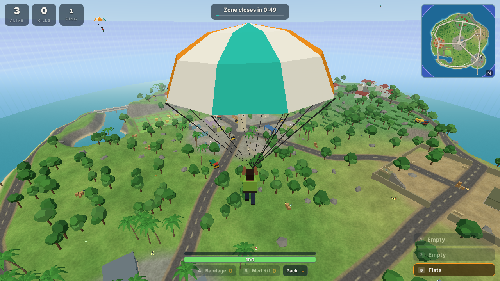
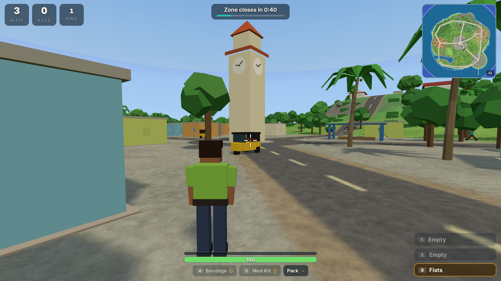
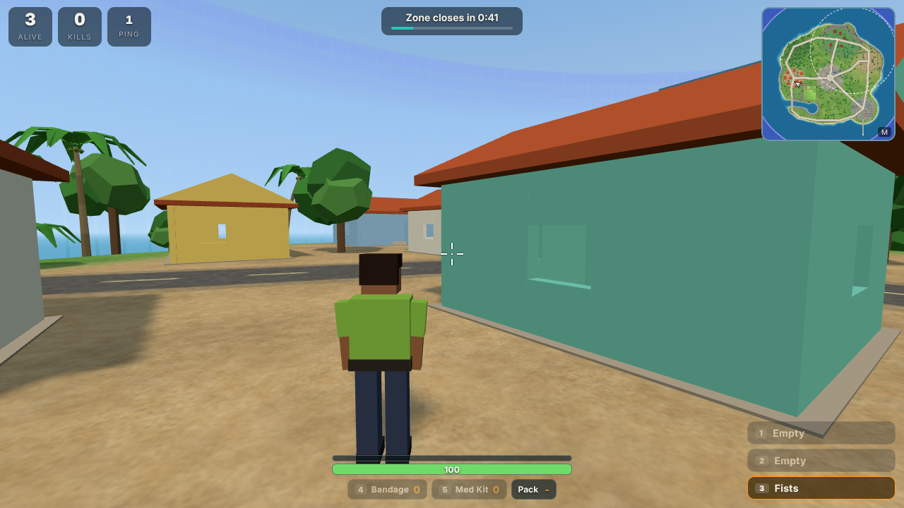
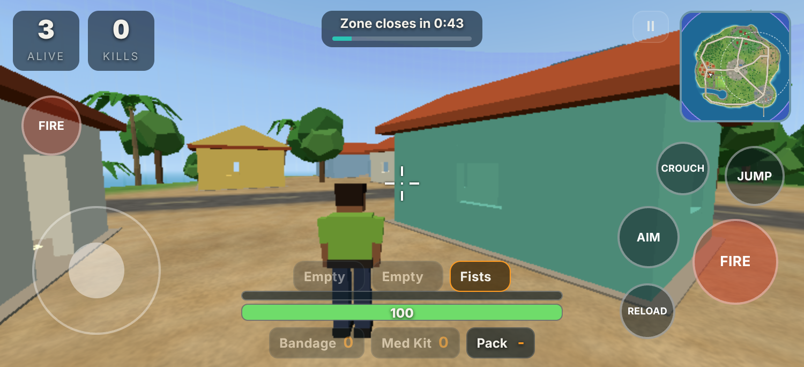
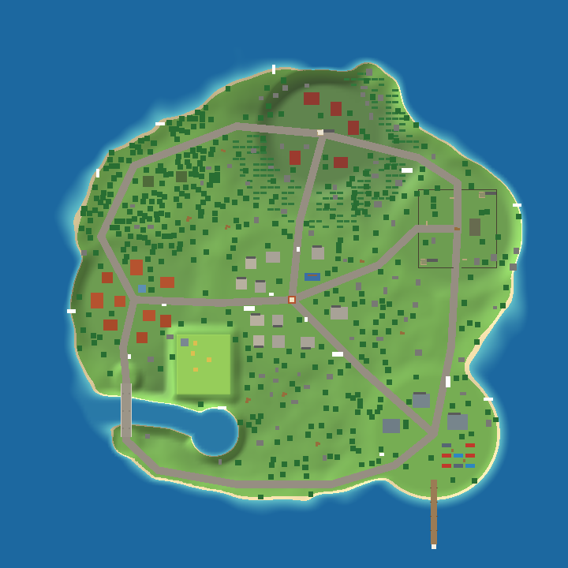

# Project Last Stand

An original 3D multiplayer battle royale you play in the browser. Parachute onto Aindinai Island, a fictional island inspired by the landscapes of South India, scavenge weapons and armour, stay inside the shrinking safe zone, and be the last one standing.



| Sangam Junction | Marutham Village | On a phone |
| --- | --- | --- |
|  |  |  |

It runs on Windows, Android and iOS (and macOS/Linux) in any modern browser, with keyboard and mouse or touch controls. There is nothing to install for players: they open a link.

> **About the technology.** The original design blueprint ([docs/DESIGN.md](docs/DESIGN.md)) proposed Unreal Engine 5. This implementation keeps that design (third-person shooter, authoritative dedicated server, loot, inventory, shrinking zone, last player wins) but is built with web technology (Three.js client, Node.js server) so that it can be run, tested and played immediately on every target platform. See [Roadmap](#roadmap) for what is and is not done.

## Quick start

You need [Node.js](https://nodejs.org) 20 or newer.

```bash
npm install
npm start
```

Open <http://localhost:3000>, type a name and press **Practice** to play against bots straight away.

To play with other people on the same Wi-Fi, give them `http://<your-computer's-IP>:3000`. **Quick Match** puts everyone who presses it into the same lobby; **Private Room** puts everyone who types the same room code together. Bots fill the remaining seats.

On Android and iOS the game plays in landscape. Once the server is deployed behind HTTPS, "Add to Home Screen" in the browser menu installs it like an app that opens fullscreen.

## How to play

1. You start under a parachute. Steer toward buildings: that is where most gear is.
2. Walk over items to pick them up. Weapons need a free slot; press **F** to swap the weapon in your hand for one on the ground.
3. A timer at the top shows when the safe zone closes. The white dashed circle on the map is the next safe zone; outside the purple wall you lose health, faster each phase.
4. The last player alive wins. After you are eliminated you can spectate.

### Controls

| Action | Keyboard and mouse | Touch |
| --- | --- | --- |
| Move | W A S D | Left thumb stick (push far forward to sprint) |
| Look | Mouse (click the game once to capture it) | Drag on the right half of the screen |
| Fire | Left click | FIRE buttons |
| Aim down sights / scope | Hold right click | AIM (toggle) |
| Sprint | Shift | Push the stick far forward |
| Jump | Space | JUMP |
| Crouch | C (toggle) or left Ctrl (hold) | CROUCH (toggle) |
| Reload | R | RELOAD |
| Switch weapon | 1, 2, 3, Q or mouse wheel | Tap a weapon slot |
| Pick up / swap weapon | F | TAKE |
| Drop weapon | G | - |
| Bandage / Med Kit | 4 / 5 (H picks one for you) | Tap the item |
| Map | M | Tap the minimap |
| Settings | Esc | II button |
| Next spectated player | N or Space | Next player |

### Weapons and items

| Weapon | Ammo | Damage | Rate (rpm) | Magazine | Best at |
| --- | --- | ---: | ---: | ---: | --- |
| Minnal P9 pistol | 9mm | 22 | 330 | 12 | Close range backup |
| Kathir SMG | 9mm | 17 | 820 | 30 | Close range |
| Vel-7 Rifle | 5.56 | 25 | 600 | 30 | Medium range all-rounder |
| Idi-12 Shotgun | 12 Gauge | 8 x 12 | 75 | 5 | Point blank |
| Garuda LR sniper | 7.62 | 80 | 42 | 5 | Long range, 4.5x scope |
| Fists | - | 24 | 120 | - | When you have nothing else |

Headshots do 1.3x to 2.5x damage depending on the weapon, leg shots 0.75x, and damage falls off with distance. Vests absorb half of incoming bullet damage until they break (Light 50, Heavy 100). Bandages restore 20 health up to 75; Med Kits restore to full. Backpacks raise how much ammunition and how many healing items you can carry. All of these numbers live in [`shared/items.js`](shared/items.js).

### The map



Sangam Junction (clock tower and market street), Marutham Village and its paddy fields, Neithal Harbour (warehouses, container yard, pier and lighthouse), Kurinji Heights (hill-station bungalows and tea terraces), Mullai Woods (forest cabins) and Paalai Outpost (walled compound with lookouts), joined by roads and a bridge over a tidal creek. The place names come from the five landscapes of classical Tamil poetry. The whole island is generated by code in [`shared/world.js`](shared/world.js); there are no art or audio files in the repository.

## How it works

```text
 Browser clients (Windows / Android / iOS)
   Three.js renderer, input, prediction, HUD, synthesised audio
              |  WebSocket (JSON), 60 inputs/s up, 30 snapshots/s down
              v
 Node.js server (one process, many matches)
   Matchmaker ---- quick match / practice / private rooms
   Match --------- movement, combat, inventory, loot, safe zone, result
   Bots ---------- A* navigation, same input path as humans
              ^
              |  both sides import the same code
 shared/  world generator, movement + collision, weapon and item data, zone schedule
```

**The server is the source of truth** for positions, health, ammunition, hits, inventory, loot, the zone and the winner. Clients send inputs and requests only.

- **Prediction and reconciliation.** The client runs the same deterministic movement code as the server on its own inputs, so controls feel instant. Each snapshot carries the server's result and the last input it processed; the client rewinds to that state and replays newer inputs.
- **Interpolation.** Other players are drawn 100 ms in the past, between two snapshots, so they move smoothly.
- **Lag compensation.** When you fire, the server rewinds other players (at most 400 ms) to where your screen showed them before tracing the shot.
- **Shots.** Muzzle flash, sound and recoil play immediately; bullet tracers, impacts, hit markers and damage come from the server's ray cast.
- **Determinism.** The island is built from a seed with integer hashing and basic arithmetic only, so the server and every browser generate an identical world and no map data is sent.

### Server-side validation

- Movement input is clamped and budgeted in simulated time, so sending inputs faster does not make a player faster.
- Fire rate, magazine, reload and weapon-swap timing are enforced by the server; a client cannot fire without ammunition or between shots.
- Bullet spread is rolled on the server.
- Pickups are range-checked and processed one at a time, so two players cannot take the same item.
- Messages are size-limited (16 KB), rate-limited per connection, and malformed or out-of-order input is ignored. Names are sanitised and always rendered as text.
- The HTTP server only serves files from `client/`, `shared/` and the Three.js package.

This is a reasonable baseline, not anti-cheat. In particular every client currently receives every player's position, so a modified client could reveal enemies through walls, and nothing detects aim assistance. Treat a public deployment accordingly.

## Project structure

```text
client/            Browser game (plain ES modules, no build step)
  index.html, style.css
  js/main.js       menus, lobby, settings, render loop
  js/game.js       one match: prediction, interpolation, camera, events
  js/scene.js      terrain, buildings, trees, props, sky, water, map image
  js/models.js     characters, weapons, loot
  js/effects.js    tracers, muzzle flashes, impacts, zone wall
  js/hud.js        HUD and minimap
  js/input.js      keyboard, mouse and touch
  js/audio.js      synthesised sound effects
  js/net.js        WebSocket connection
server/
  index.js         HTTP + WebSocket entry point
  matchmaker.js    quick match, practice, private rooms
  match.js         authoritative match simulation
  bot.js, nav.js   bots and their navigation grid
  inventory.js     inventory transactions
  combat.js        damage, armour, spread, tie-breaking
shared/            Code used by both sides
  constants.js, items.js, zone.js, world.js, physics.js, rng.js
tests/             Unit, match-rule and end-to-end tests
scripts/
  render-map.mjs   writes a top-down PNG of the island
  browser-smoke.mjs two-browser multiplayer smoke test
  make-icons.mjs   regenerates the app icons
docs/DESIGN.md     the original design blueprint
```

## Configuration

Set these environment variables when starting the server.

| Variable | Default | Meaning |
| --- | --- | --- |
| `PORT` | `3000` | Port for HTTP and WebSocket |
| `HOST` | `0.0.0.0` | Address to listen on |
| `MAX_PLAYERS` | `16` | Players per match, humans plus bots (up to 32) |
| `BOT_FILL` | `12` | Bots are added until a match has this many players |
| `BOTS` | on | Set to `0` to disable bots |
| `LOBBY_SECONDS` | `20` | Quick Match countdown (everyone pressing Ready shortens it to 3 s) |
| `ZONE_SCALE` | `1` | Multiplies every zone timer, e.g. `0.5` for matches half as long |
| `MAX_CLIENTS` | `200` | Connection limit |
| `DEBUG_SPAWN` | off | `1` lets a client choose its start position with `?spawn=x,z,yaw`. For development only |

A match takes about five minutes with the default zone schedule ([`shared/zone.js`](shared/zone.js)).

## Tests

```bash
npm test
```

runs 65 tests with Node's built-in test runner: inventory rules, damage and armour, zone geometry and schedule, movement and collision, world generation (determinism, loot placement, reachability), match rules (fire rate, ammunition, speed-hack guard, duplicate pickups, lag compensation, healing, simultaneous eliminations, disconnects, lobby), and a real server with WebSocket clients playing a private room from lobby to result.

```bash
npm install --no-save playwright && npx playwright install chromium
npm run test:browser
```

opens two real browser tabs against a private server and checks that they see each other move and that the match ends correctly.

`npm run map` regenerates `docs/map.png`, which is a quick way to check changes to the map generator.

## Deployment

The game is one Node.js process that serves the client and the WebSocket endpoint (`/ws`) on the same port. Any host that runs a long-lived Node process and allows WebSockets works: a VPS, or a container platform such as Fly.io, Railway or Render. Static or serverless-function hosting alone is not enough, because matches live in server memory.

```bash
docker build -t last-stand .
docker run -p 3000:3000 last-stand
```

Put it behind HTTPS for public use (the client switches to `wss://` automatically), which is also required for fullscreen and screen wake-lock on phones. One process holds all matches in memory, so restarting the server ends the matches in progress.

## Roadmap

Status against the vertical slice in the design blueprint:

- [x] Small original map with collision and cover
- [x] Replicated third-person movement and camera, client prediction
- [x] Server-authoritative weapons, damage and ammunition (five guns and melee)
- [x] Health, armour, elimination and spectating
- [x] Loot, pickups, inventory with capacity, weapon swap and drop
- [x] Shrinking safe zone with damage outside it
- [x] Dedicated server with many clients, lobby, match start and end, winner and results
- [x] Touch controls and a low graphics setting for phones
- [x] Bots, so the game is playable alone (Practice mode)
- [x] Automated unit, rule and smoke tests

Not built yet:

- Duo and Squad modes, teammate revive
- Grenades and smoke, weapon attachments, vehicles, swimming animations, vaulting
- Accounts, friends, progression, cosmetics, ranked play
- Rejoining a match after a disconnect, spectating from the lobby
- Relevancy filtering (only sending players you could see) and binary snapshots, which larger matches and stronger cheat resistance both need
- Load testing beyond 16 players; the 50 to 100 player target needs measurement first
- Native app packaging for the stores (the web client can be wrapped, or the design ported to an engine such as Unreal as the blueprint describes)

## Notes

- Everything in the game (map, characters, weapons, names, sounds) is original and generated by the code in this repository. It is inspired by the battle royale genre and does not use content from any existing game.
- Dependencies: [three](https://github.com/mrdoob/three.js) and [ws](https://github.com/websockets/ws), both MIT licensed.
- No licence has been chosen for this project yet. Pick one before publishing or accepting contributions.
