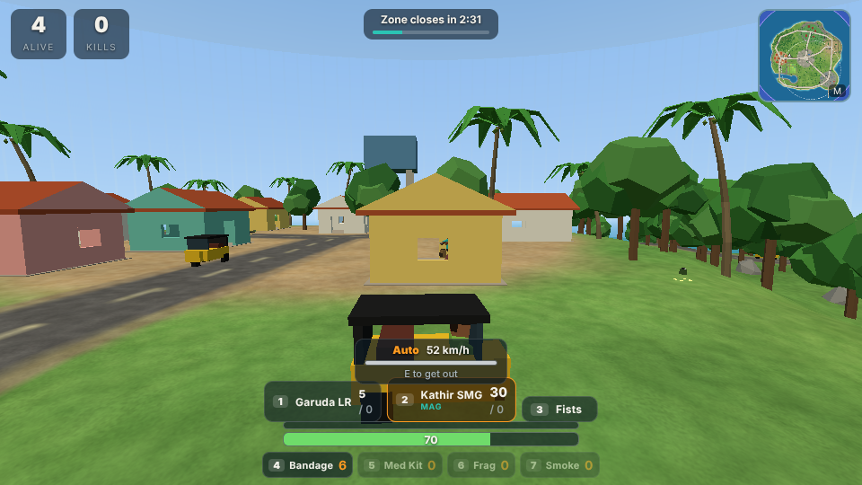

# Project Last Stand

An original 3D multiplayer battle royale you play in the browser. Parachute onto Aindinai Island, a fictional island inspired by the landscapes of South India, scavenge weapons and armour, drive an auto-rickshaw across the map, stay inside the shrinking safe zone, and be the last player or team standing.

**Live:** <https://project-last-stand-pi.vercel.app>


| Sangam Junction | Driving an auto | On a phone |
| --- | --- | --- |
|  |  |  |

It runs on Windows, Android and iOS (and macOS/Linux) in any modern browser, with keyboard and mouse or touch controls. There is nothing to install for players: they open a link.

> **About the technology.** The original design blueprint ([docs/DESIGN.md](docs/DESIGN.md)) proposed Unreal Engine 5. This implementation keeps that design (third-person shooter, authoritative dedicated server, loot, inventory, vehicles, squads, shrinking zone) but is built with web technology (Three.js client, Node.js server) so that it can be run, tested and played immediately on every target platform.

## Quick start

You need [Node.js](https://nodejs.org) 22 or newer.

```bash
npm install
npm start
```

Open <http://localhost:3000>, type a name and press **Practice** to play against bots straight away.

To play with other people on the same Wi-Fi, give them `http://<your-computer's-IP>:3000`.

On Android and iOS the game plays in landscape. From an HTTPS address (such as the live link above), "Add to Home Screen" in the browser menu installs it like an app that opens fullscreen.

## Game modes

Pick **Solo**, **Duo** or **Squad** (teams of four) at the top of the menu, then:

| Button | What it does |
| --- | --- |
| Quick Match | Joins the public lobby for that team size. Bots fill the empty seats. |
| Practice | Starts at once: you (and bot team-mates in Duo/Squad) against bots. |
| Private Room | Everyone who enters the same room code plays together. The lobby shows an invite link to send to friends. |
| Watch a live match | Spectates the busiest match in progress. |
| Profile | Your level, stats, outfit and hat, and the server's leaderboard. |

Players who enter a lobby together are put on the same team.

## How to play

1. You start under a parachute. Steer toward buildings: that is where most gear is.
2. Walk over items to pick them up. Weapons need a free slot; press **F** to swap the weapon in your hand for one on the ground.
3. Autos and lorries parked around the island can be driven. Press **E** next to one; the first person in drives, the rest ride and can shoot.
4. A timer at the top shows when the safe zone closes. The white dashed circle on the map is the next safe zone; outside the purple wall you lose health, faster each phase.
5. In Duo and Squad, running out of health knocks you down instead of eliminating you while a team-mate is still standing. A team-mate can revive you by holding position next to you after pressing **E**; otherwise you bleed out in 35 seconds.
6. The last player or team alive wins. After you are eliminated you can spectate.

### Controls

| Action | Keyboard and mouse | Touch |
| --- | --- | --- |
| Move / drive | W A S D | Left thumb stick (push far forward to sprint) |
| Look | Mouse (click the game once to capture it) | Drag on the right half of the screen |
| Fire | Left click | FIRE buttons |
| Aim down sights / scope | Hold right click | AIM (toggle) |
| Sprint | Shift | Push the stick far forward |
| Jump, climb a ledge, handbrake | Space (hold at a ledge to climb) | JUMP |
| Crouch | C (toggle) or left Ctrl (hold) | CROUCH (toggle) |
| Reload | R | RELOAD |
| Switch weapon | 1, 2, 3, Q or mouse wheel | Tap a weapon slot |
| Pick up / swap weapon | F | TAKE |
| Get in or out of a vehicle, revive | E | DRIVE / RIDE / EXIT / REVIVE button |
| Drop weapon | G | - |
| Bandage / Med Kit | 4 / 5 (H picks one for you) | Tap the item |
| Frag grenade / Smoke grenade | 6 / 7 | Tap the item |
| Map | M | Tap the minimap |
| Settings | Esc | II button |
| Next spectated player | N or Space | Next player |

### Weapons and items

| Weapon | Ammo | Damage | Rate (rpm) | Magazine | Best at |
| --- | --- | ---: | ---: | ---: | --- |
| Minnal P9 pistol | 9mm | 22 | 330 | 12 | Close range backup |
| Kathir SMG | 9mm | 17 | 820 | 30 | Close range |
| Vel-7 Rifle | 5.56 | 25 | 600 | 30 | Medium range all-rounder |
| Idi-12 Shotgun | 12 Gauge | 8 x 12 | 75 | 5 | Point blank |
| Garuda LR sniper | 7.62 | 80 | 42 | 5 | Long range, 4.5x scope |
| Fists | - | 24 | 120 | - | When you have nothing else |

- **Hits.** Headshots do 1.3x to 2.5x damage depending on the weapon, leg shots 0.75x, and damage falls off with distance.
- **Attachments** fit themselves onto a compatible weapon you carry and stay on it when dropped: Extended Mag (+50% magazine, all guns), 2.5x Scope (rifle, SMG), Recoil Grip (rifle, SMG, shotgun).
- **Throwables.** Frag grenades (2.6 s fuse, 7.5 m blast, also hurts the thrower; walls shield) and smoke grenades (a cloud for 14 s that also blocks bots' sight).
- **Protection and healing.** Vests absorb half of incoming bullet damage until they break (Light 50, Heavy 100). Bandages restore 20 health up to 75; Med Kits restore to full. Backpacks raise how much you can carry.
- **Vehicles.** Auto (3 seats, 54 km/h) and Lorry (2 seats, 45 km/h). Bullets and grenades damage them; at zero they explode. Driving into people hurts them.

All of these numbers live in [`shared/items.js`](shared/items.js) and [`shared/vehicle.js`](shared/vehicle.js).

### Profile and progression

Every finished match earns experience (kills, damage, placing, a win bonus). Levels unlock ten outfits and four hats, which other players see. The profile is stored in your browser; there are no accounts or passwords. The server keeps a leaderboard of ranked points, identified by a random id from your browser.

### The map


Sangam Junction (clock tower and market street), Marutham Village and its paddy fields, Neithal Harbour (warehouses, container yard, pier and lighthouse), Kurinji Heights (hill-station bungalows and tea terraces), Mullai Woods (forest cabins) and Paalai Outpost (walled compound with lookouts), joined by roads and a bridge over a tidal creek. The place names come from the five landscapes of classical Tamil poetry. The whole island is generated by code in [`shared/world.js`](shared/world.js); there are no art or audio files in the repository.

## How it works

```text
 Browser clients (Windows / Android / iOS)
   Three.js renderer, input, prediction, HUD, synthesised audio
              |  WebSocket (compressed JSON), 60 inputs/s up, 30 snapshots/s down
              v
 Node.js server (one process, many matches)
   Matchmaker ---- quick match / practice / private rooms / watching
   Match --------- movement, vehicles, combat, teams, inventory, loot, zone, result
   Bots ---------- A* navigation, same input path as humans
              ^
              |  both sides import the same code
 shared/  world generator, character and vehicle physics, item data, zone schedule
```

**The server is the source of truth** for positions, health, ammunition, hits, inventory, loot, vehicles, the zone and the winner. Clients send inputs and requests only.

- **Prediction and reconciliation.** The client runs the same deterministic movement code as the server on its own inputs (on foot and at the wheel), so controls feel instant. Each snapshot carries the server's result and the last input it processed; the client rewinds to that state and replays newer inputs.
- **Interpolation.** Other players and vehicles are drawn 100 ms in the past, between two snapshots, so they move smoothly.
- **Lag compensation.** When you fire, the server rewinds other players (at most 400 ms) to where your screen showed them before tracing the shot.
- **Determinism.** The island is built from a seed with integer hashing and basic arithmetic only, so the server and every browser generate an identical world and no map data is sent. Thrown grenades are simulated by the same shared code on both sides from just their launch state.
- **Staying connected.** A dropped connection keeps your seat for 20 seconds; the client reconnects and resumes the same match. Hosts that limit how long a connection may stay open (see Vercel below) are handled by moving to a fresh connection before the limit, without interrupting play.
- **Bandwidth.** Players further than 230 m are not sent to you (team-mates always are), and WebSocket compression cuts snapshot traffic by about 70%.

### Server-side validation

- Movement input is clamped and budgeted in simulated time, so sending inputs faster does not make a player or vehicle faster.
- Fire rate, magazine, reload and weapon-swap timing are enforced by the server; a client cannot fire without ammunition or between shots. Bullet spread is rolled on the server.
- Pickups, vehicle entry and revives are range-checked and processed one at a time, so two players cannot take the same item or seat.
- Messages are size-limited (16 KB), rate-limited per connection, and malformed or out-of-order input is ignored. Names are sanitised and always rendered as text.

This is a reasonable baseline, not anti-cheat. Clients still receive the positions of everyone within 230 m, so a modified client could reveal nearby enemies through walls, and nothing detects aim assistance.

## Project structure

```text
client/            Browser game (plain ES modules, no build step)
  index.html, style.css, manifest.webmanifest
  js/main.js       menus, lobby, profile, settings, render loop
  js/game.js       one match: prediction, interpolation, camera, events
  js/scene.js      terrain, buildings, trees, props, sky, water, map image
  js/models.js     characters, outfits, weapons, vehicles, loot
  js/effects.js    tracers, flashes, explosions, smoke, zone wall
  js/hud.js        HUD, team panel, minimap
  js/input.js      keyboard, mouse and touch
  js/audio.js      synthesised sound effects
  js/net.js        connection, reconnect and hand-over
  js/profile.js    local profile and progression
server/
  index.js         HTTP + WebSocket entry point, sessions
  matchmaker.js    quick match, practice, private rooms, watching
  match.js         authoritative match simulation
  bot.js, nav.js   bots and their navigation grid
  inventory.js     inventory transactions
  combat.js        damage, armour, spread, tie-breaking
  leaderboard.js   ranked points
  selftest.js      protocol check used by /api/ws?selftest and scripts
shared/            Code used by both sides
  constants.js, items.js, cosmetics.js, zone.js, world.js, physics.js, vehicle.js, rng.js
api/ws.js          Vercel Function entry (wraps server/index.js)
tests/             Unit, rule and end-to-end tests
scripts/
  playthrough.mjs  functional test: plays every feature in a real browser
  browser-smoke.mjs two-browser multiplayer smoke test
  check-server.mjs checks any running server from outside
  loadtest.mjs     measures tick time and bandwidth for 16 to 100 players
  build-static.mjs builds public/ for static hosting
  render-map.mjs, make-icons.mjs
docs/              design blueprint, test report, screenshots
```

## Configuration

Set these environment variables when starting the server.

| Variable | Default | Meaning |
| --- | --- | --- |
| `PORT` | `3000` | Port for HTTP and WebSocket |
| `HOST` | `0.0.0.0` | Address to listen on |
| `MAX_PLAYERS` | `16` | Players per match, humans plus bots (up to 100) |
| `BOT_FILL` | `12` | Bots are added until a match has this many players |
| `BOTS` | on | Set to `0` to disable bots |
| `LOBBY_SECONDS` | `20` | Quick Match countdown (everyone pressing Ready shortens it to 3 s) |
| `ZONE_SCALE` | `1` | Multiplies every zone timer, e.g. `0.5` for matches half as long |
| `RESUME_GRACE` | `20` | Seconds a disconnected player keeps their seat |
| `CONN_TTL` | `0` | Seconds a connection may live before clients move to a new one (for hosts with a time limit) |
| `DATA_DIR` | none | Folder where the leaderboard is saved; without it the leaderboard is kept in memory |
| `WS_COMPRESS` | on | Set to `0` to turn WebSocket compression off |
| `MAX_CLIENTS` | `200` | Connection limit |
| `STATIC_DIR` | none | Serve one pre-built folder (the output of `npm run build`) instead of the source folders |
| `DEBUG_SPAWN` | off | `1` enables test helpers (chosen start position, giving items). Never on a public server |

A match takes about five minutes with the default zone schedule ([`shared/zone.js`](shared/zone.js)).

## Tests

| Command | What it covers |
| --- | --- |
| `npm test` | 94 unit, rule and end-to-end tests: inventory, damage, zone, physics, vehicles, teams, world generation, match rules, anti-cheat checks, reconnects, and real WebSocket clients playing a room. Runs in CI. |
| `npm run test:play` | Functional play-through in a real browser: 101 checks across menus, movement, weapons, healing, throwables, vehicles, team play, touch controls, watching, private rooms, reconnecting and finishing a match. |
| `npm run test:browser` | Smoke test: two browser tabs in one match see each other move; one leaves and the other wins. |
| `npm run check -- <url>` | Checks any running server from outside: join, start, inputs, snapshots, connection hand-over. |
| `npm run test:load` | Load test with real connections for 16, 32, 50 and 100 players. |

The browser tests need Playwright, which is not a dependency of the game: `npm install --no-save playwright && npx playwright install chromium`.

The latest full round is written up in [docs/TEST-REPORT.md](docs/TEST-REPORT.md).

## Deployment

### Vercel (how the live link is hosted)

The repository deploys to Vercel as it is:

- `scripts/build-static.mjs` builds the client into `public/`, which Vercel's CDN serves.
- `api/ws.js` runs the game server as a Vercel Function. Vercel Functions accept WebSocket connections when they export a Node.js HTTP server with a `ws` server attached, which is what the game server is.
- `vercel.json` sets the region (`bom1`, Mumbai; change it to the region closest to your players) and the function's maximum duration.

Things to know about this setup:

- A function may run for at most 300 seconds on the Hobby plan, and an open connection ends with it. The server announces this limit (`CONN_TTL`) and clients move to a new connection beforehand, so players do not notice.
- Matches live in the memory of one function instance. That works while everyone reaches the same instance, which is what happens at small scale. Under heavy traffic Vercel may start more instances, and players on different instances cannot meet. A reconnect that lands on another instance loses the match. For a large public audience, run the server on a long-lived host (below) instead.
- The leaderboard is kept in memory, so it resets whenever the function instance is recycled.
- Function time is metered by Vercel. The client only holds a connection while in a lobby or match, never on the menu.

`GET /api/ws?selftest=full` makes a deployment test itself: it connects to its own public address, starts a practice match, sends inputs, checks snapshots and moves the session to a second connection.

### Any Node.js host

The game is one Node.js process that serves the client and the WebSocket endpoint (`/api/ws`) on the same port. Any host that runs a long-lived Node process works: a VPS, or a container platform.

```bash
docker build -t last-stand .
docker run -p 3000:3000 -e DATA_DIR=/data -v last-stand-data:/data last-stand
```

Put it behind HTTPS for public use (the client switches to `wss://` automatically).

## Roadmap

Built:

- [x] Original map with collision and cover; third-person movement with prediction, vaulting and swimming
- [x] Five guns, melee, attachments, frag and smoke grenades, armour, healing, backpacks
- [x] Loot, inventory with capacity, weapon swap and drop
- [x] Drivable vehicles with passengers, damage and explosions
- [x] Solo, Duo and Squad with knock-down and revive
- [x] Shrinking safe zone; lobby, match start and end, results
- [x] Bots that fight, loot, drive nothing, revive team-mates and fill empty seats
- [x] Reconnecting to a match in progress; watching live matches; private rooms with invite links
- [x] Profile, levels, outfits and hats; server leaderboard
- [x] Touch controls and a low graphics setting for phones; installable as a home-screen app
- [x] Relevancy filtering, compressed snapshots, load-tested to 100 players per match
- [x] Automated unit, functional, smoke and load tests; deployed on Vercel

Not built:

- Accounts with sign-in, friends lists and a permanent ranked ladder. These need an identity provider and a database, which is a product decision (and on Vercel, a storage add-on).
- Native store packages (APK/IPA). The web app installs to the home screen; store builds need the Android and Apple toolchains and signing keys.
- Vehicles do not collide with each other, and bots do not drive.
- Attachments are shown in the HUD but not on the weapon models.
- The map is sized for up to about 30 players. The server copes with 100 (see the load test), but the island would be crowded.
- Voice or text chat, replays and kill-cams.

## Notes

- Everything in the game (map, characters, weapons, vehicles, names, sounds) is original and generated by the code in this repository. It is inspired by the battle royale genre and does not use content from any existing game.
- Dependencies: [three](https://github.com/mrdoob/three.js) and [ws](https://github.com/websockets/ws), both MIT licensed.
- No licence has been chosen for this project yet. Pick one before publishing or accepting contributions.
